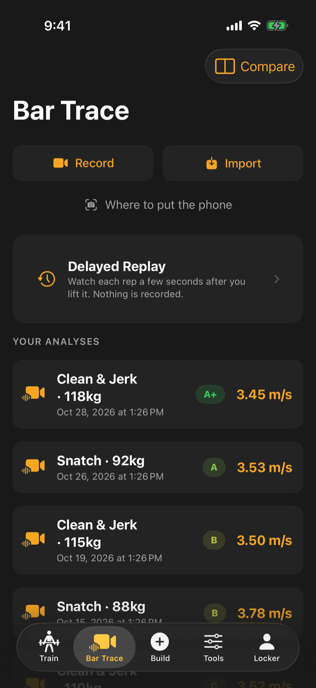

Bar Trace turns a video of your lift into a line showing where the bar travelled, plus a grade and the things worth fixing. You can film inside the app or bring in a clip you already have.

## Set up the phone

The first time you tap Record or Import, the app shows a short guide. You can reopen it any time from "Where to put the phone".

- Stand the phone side-on, at a right angle to the bar, so the end of the bar points at the lens.
- Put it about 3 to 5 metres back, around hip height, on something steady.
- Keep your whole lift in frame, with room above you for the bar overhead.
- Make sure the plate nearest the camera is clearly visible at the start.

Standing too close is the most common problem: the plate looks oversized and the bar can leave the top of the frame.

## Record or import a clip

1. Open the Bar Trace tab.
2. Tap **Record** to film, or **Import** to pick a clip from your phone's video picker (your photo library on iPhone).
3. When recording, you can flip between the back and front cameras, pinch to zoom, and use the rotate button if the phone is lying flat or leaning on a plate. The front camera preview looks mirrored, but the saved clip is not.

A clip you record in the app is also saved to your photo library, so the video survives a new phone or a reinstall. The first time, iPhone asks for permission to add to Photos. Clips you import are already in your library and are not copied again.

:::note[Android]
Recorded clips are copied to your gallery, in the Movies folder under Lifting Lab, on Android 10 and newer, with no permission prompt. On Android 9 and older the clip stays in the app only, so keep your own copy if you want one.
:::

## Trim the clip

If you filmed yourself walking to the bar and back, trim the clip so only the lift is analysed. Drag the two handles to the stretch you want. The video file itself is never cut, so nothing is lost. Skipping the trim analyses the whole clip, which just takes longer.

## Mark the plate

Drag the circle over the plate nearest the camera and size it to match. This tells the app what to follow and gives it a sense of scale. The app often suggests a circle for you, so check it sits on the plate and adjust if not.

:::tip
If the trace fails, the app takes you back to the circle. Most failures are a circle that sat slightly off the plate, so nudge it and try again.
:::

## Read the result

The bar path is traced on your phone (on iPhone with Apple's built-in vision tools, on Android with its own on-device analysis). From the top of the result screen down you get:

1. Your video with the traced path.
2. Whether the lift would count, shown as three referee-style lights (for the snatch, clean, and their variations).
3. A technique grade, with a bar for each part of the lift.
4. What to fix first, with drills that address it.
5. Speed, phase and position details. Tap a row or drag the graph to jump to that moment in the video.

Once you have two or more lifts of the same type, numbers are compared with your own average. If something could not be read, the card says why.

## Replay it a few seconds late

Delayed Replay shows the camera feed 3, 5, 8 or 10 seconds behind. Prop the phone up, lift, and turn around to watch the rep without touching anything. Nothing is recorded or saved, and it does not use up an analysis.

## Share, compare and manage

- **Share** makes a vertical clip with the trace and stats on it.
- **Compare** overlays two analyses (Pro). On a Free plan the Compare button is still there: tap it and Lifting Lab shows what Pro adds and how to get it.
- **Re-analyze** and **Delete** are in the menu on the result screen.

:::note
Free accounts can run three analyses a month. Pro removes the limit. A failed trace does not count against it. Once you have used the three, the Bar Trace tab says so and offers **Analyse Without Limits**.
:::
