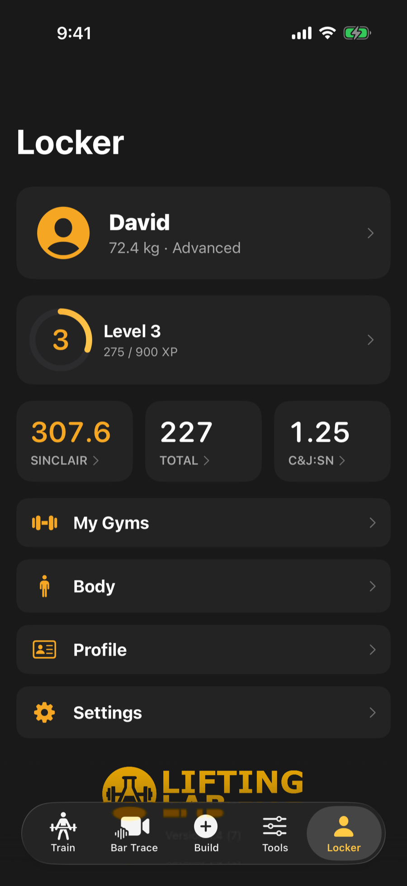

The Locker tab is about you: who you are as a lifter, how you are progressing, and how the app behaves.

<video controls playsinline preload="none" poster="/help/videos/v2/K4-poster.webp" width="300" aria-describedby="K4-desc">
  <source src="/help/videos/v2/K4.mp4" type="video/mp4">
  <track kind="captions" src="/help/videos/v2/K4.vtt" srclang="en" label="English" default>
</video>

<em>Video, 22 seconds, with narration and captions. 275 / 900 XP to level 4. Records, lifts analyzed, sessions and more. Tracked on the same screen.</em>

## Your profile and numbers

The top of the Locker shows your photo, age category, bodyweight and experience, plus your level, XP and streak. Three stats sit underneath: Sinclair, your total, and your clean and jerk to snatch ratio. Tap any of them to open the tool that works it out. That includes a stat showing a dash, where the tool will tell you what is missing.

Open your profile to set your name, coach's name, date of birth, bodyweight, weight class, photo and height.<!-- since 1.5 --> A Technique section walks you through finding your grip, squat stance, lead leg and dip depth.<!-- /since -->

Other sections in the Locker:

- **My Gyms**: your home, club and competition gyms, each with its own bar and plates. Workouts and tools use your default gym.
- **Body**: log an area you are training around, check in with a pain rating, and see how the app adjusts. It changes your training, not your treatment.

## Progress, XP and badges

Tap the level strip to see your level, an XP breakdown, your streak and your badges. Each badge shows how close you are, and you can share a progress card as an image.

## Settings

Open Settings from the Locker. The main rows are:

- **Training**: rest timer, bar choice, your warm-up ramp, and how custom workouts pick exercises.
- **Reset Your Numbers**: coming back from illness or injury? Enter what you can lift now and workouts load from that. Your records stay untouched.
- **Apple Health** (Health Connect on Android): four switches for adapting rest, suggesting readiness, saving workouts and syncing bodyweight.
- **Film Room**: the grading level for technique grades. It never changes the referee lights.
- **Sounds**, and **Units** for kilograms or pounds.
- **Data and Privacy**: clip storage, <!-- since 1.5 -->exporting your data as CSV files, <!-- /since -->the Privacy Policy and Terms.

## Accessibility

<!-- since 1.5 -->

In Settings, the Accessibility section has four switches:

- **Spoken rest cues**: says when 30 seconds remain, then when rest is over and what is next.
- **Show charts as tables**: opens a table of the same numbers under every chart.
- **Accessibility view**: draws your next set very large with bigger Made and Miss buttons and clear edges on controls.

<!-- /since -->

- **Reduce celebrations**: skips confetti, haptics and sounds. You still earn XP and badges.

## Subscription

The Subscription section shows your plan and lets you view Pro. **Restore Purchases** brings back a subscription after reinstalling or moving to a new phone. If you have a subscription, **Manage Subscription** opens your Apple settings.

<!-- since 1.5 -->

## Help and support

Help now lives in Settings. **How-to Guides** opens these articles and needs an internet connection. **Contact Support** opens the support page.

<!-- /since -->

:::tip
Switching to a new iPhone? Tap Restore Purchases once you have signed in with the same Apple ID.
:::

:::note[Android]
On Android, Pro is billed to your Google Play account. While you are on Free, the Subscription screen lists what Pro includes above the plan buttons. If prices cannot load there is a Try Again button, and if a purchase does not go through, a line under the buttons says so. If you pay with a slower method such as cash or a bank transfer, the screen says the payment is pending, and Pro unlocks as soon as Google Play confirms it. Buying again does not speed it up. Once you have Pro, the screen has a Manage in Google Play button to change or cancel it. There is no Restore Purchases button: the app checks Google Play for your subscription itself, so a new phone signed in with the same Google account gets Pro back.
:::
