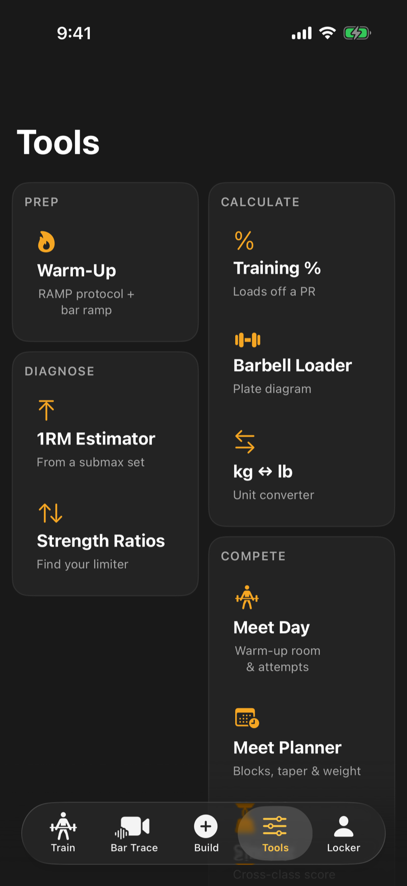

The Tools tab holds quick calculators and planners. They work offline, and weights show in the unit you chose in Settings.

<video controls playsinline preload="none" poster="/help/videos/v2/I4-poster.webp" width="300" aria-describedby="I4-desc">
  <source src="/help/videos/v2/I4.mp4" type="video/mp4">
  <track kind="captions" src="/help/videos/v2/I4.vtt" srclang="en" label="English" default>
</video>

<em>Video, 21 seconds, with narration and captions. 100 kg: 25 + 15 per side, exact. 103 kg on a 15 kg bar, exact.</em>

## What is in there

**Prep**

- **Warm-Up**: a guided warm-up, using your own routine if you have written one.

<!-- since 1.5 -->

- **Complex Builder** (Pro): chain lifts on one bar and check every transition. See [Build and log a complex](/help/train/complexes/).

<!-- /since -->

**Calculate**

- **Training %**: working weights at each percentage of a lift, with the plates to load. A lift you reset under Reset Your Numbers loads from that number, not its old record.
- **Barbell Loader**: shows which plates to put on the bar for a target weight.
- **kg and lb**: converts between the two.

**Diagnose**

- **1RM Estimator**: estimates your one-rep max from a lighter set.
- **Strength Ratios**: compares your lifts against each other to show what is holding you back.

**Compete**

- **Meet Day** (Pro): a warm-up room and six-attempt board<!-- since 1.5 -->, with a clock for attempt timing and a check of your attempts against the platform rules. Type your official weigh-in on the setup screen, or change it on the meet screen once you have weighed in: the Sinclair score and the saved meet use that number, not the weight in your profile. The attempt count, the warm-up marker and the clock stay where you left them if you switch tabs or the app closes mid-meet<!-- /since -->.

<!-- since 1.5 -->

- **Meet Planner** (Pro): counts down to your meets and works your training blocks backward from them. Opening it does not plan a meet: nothing is saved until you change the name, date, priority or target class. In the days before a meet, workouts you build drop their volume, use lighter loads in the last two days, and give only recovery work on meet day.

<!-- /since -->

- **Sinclair**: a score that lets you compare totals across bodyweights.
- **Robi Points**: your total against the world record for your category.

Pro tools show a lock until you subscribe, and a locked screen has a See Pro button that opens the subscription.

## Load the bar

1. Open **Barbell Loader**.
2. Type your target weight, or use the stepper.
3. Choose your bar from the **Bar** menu.
4. Read the plate drawing and the per-side list.

The loader uses the plates in your default gym. To change them, go to Locker, then My Gyms. If the target is lighter than the bar, you will see a message saying so.

:::tip
Opening a tool from a workout or a logged set can fill in the weight for you.
:::

## Estimate your one-rep max

1. Open **1RM Estimator**.
2. Enter the weight you lifted.
3. Set the number of reps with the stepper (1 to 15).
4. Pick a formula from the **Formula** menu if you want a different one. The estimate and a table of percentages update straight away.
5. To keep the number, choose the lift and tap the button that sets it as your PR. You will be asked to confirm.

Estimates get less reliable as reps go up, so sets of five or fewer give the best guide.

:::note
An estimated PR is only a starting point. It stays your PR, and programs keep loading from it, until you log a heavier single. A lift you make at a meet that is heavier than anything you have actually lifted is still saved as a competition PR, even when the estimate is higher. To let your real lifts take over from an estimate, delete it from the lift's history in the PR Tracker.
:::

## Strength Ratios in a nutshell

Enter or load your lifts and the screen shows which ratios sit inside a healthy range and which one to work on first. Numbers you type over are treated as "what if", and never count as real records.
