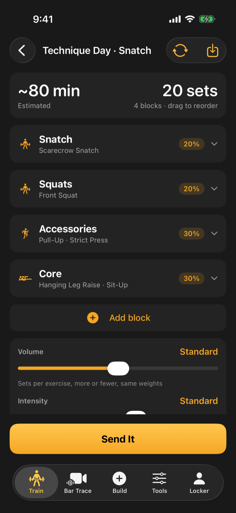

The workout builder is for days when you are not following a program. You answer a few questions about how you feel, the app drafts a session, and you change anything you like before you start.

<video controls playsinline preload="none" poster="/help/videos/v2/C1-poster.webp" width="300" aria-describedby="C1-desc">
  <source src="/help/videos/v2/C1.mp4" type="video/mp4">
  <track kind="captions" src="/help/videos/v2/C1.vtt" srclang="en" label="English" default>
</video>

<em>Video, 34 seconds, with narration and captions. Energy, sore muscles and time. Sore muscles avoided. Sets and time shown. Light, Normal or Heavy. One set at a time. No program needed.</em>

## Start a workout

1. Tap the **Build** button (the plus in the middle of the tab bar).
2. Tap **Build My Workout**.
3. Fill in the check-in: your energy, which muscles are sore, which blocks you want to train, and optionally how much time you have. Sore muscles are filled in from your recent training, so just adjust them.
4. Tap **Load It Up**.

If you leave the blocks blank, the app chooses the shape of the session. If you tick blocks, such as Clean & Jerk and Squats, you get exactly those and nothing bolted on. A block you tick is built even when a sore muscle would normally keep it out, such as Core on a day your core is sore, just with less work in it. Your choice is remembered for next time.

Low energy changes what you get. With the blocks left blank, an energy of 1 turns the day into a short recovery session of light technique work. With blocks ticked, you still get those blocks, with fewer sets and lighter top sets.

The "Training at" row lets you pick which gym you are in, so the bar, plates and equipment match what you actually have.

## Read the draft

The draft shows an estimated time, the total working sets and a list of blocks. A block is one part of the session, such as a lift, squats or accessories. Drag blocks to reorder them.

Cards on this screen explain the draft: what the app adjusted from your history, which weak point a choice addresses, and a "How this session was built" note that says why you are snatching today and what the time limit trimmed. Under a weak point, tap a movement listed under In this session to open that exercise. The note describes what the app did when it built the draft, so it stays the same when you edit the draft yourself.

If your sessions usually run longer than the estimate, the app fits the draft to the time your sessions really take, or to the time you gave in the check-in. A line that is greyed out is something the app noticed that changed nothing today, for example when the draft already fits your time.

Distances, such as a run, are shown in kilometres or miles to match your kg or lb setting.

## Change exercises

- **Swap:** tap Swap on an exercise<!-- since 1.5 -->. The closest matches from the same kind of lift appear first<!-- /since -->, and the list is limited to the equipment you have.

The estimated time includes the warm-up sets the session adds in front of each loaded lift, when warm-up ramps are on in Settings. If you gave a time limit, the app fits the session to it in this order: core comes out first, then the cardio it added is shortened or dropped, then accessories and working sets come down, so your main lifts are cut last. If even the shortest version runs over, the "How this session was built" note says how long it will take rather than claiming it fits.

Cards on this screen explain the draft: what the app adjusted from your history, which weak point a choice addresses, and a "How this session was built" note that says why you are snatching today and what the time limit trimmed.

## Change exercises

- **Swap:** tap Swap on an exercise. The closest matches from the same kind of lift appear first, and the list is limited to the equipment you have. The new exercise keeps the sets, and keeps the reps when it is counted the same way. A plank swapped for sit-ups gets the sit-ups' own rep count, and a rowing machine swapped for a run keeps the same number of minutes.

- **Swap:** tap Swap on an exercise. The closest matches from the same kind of lift appear first, and the list is limited to the equipment you have. Sets and reps carry over to the new exercise, but a number measured differently does not: swap a run for a rower, or a plank for sit-ups, and the new exercise starts from its own default.
- **Add exercise:** use Add exercise at the foot of a block.

<!-- since 1.5 -->

- **Remove an exercise:** tap its delete button and confirm.

<!-- /since -->

- **Remove a block:** use Remove block.<!-- since 1.5 --> Emptying a block removes it, and the time it frees is shared among the blocks that are left.<!-- /since -->

- **Remove a block:** use Remove block. Emptying a block removes it, and the time it frees is shared among the blocks that are left. Anything you set by hand in those blocks stays: typed percentages, reps and sets, dumbbell choices, Pyramid switches and the order you dragged the blocks into.
- **Add block:** use Add block to bring in a whole new part of the session.

<!-- since 1.5 -->

- **Complexes (Pro):** the exercise list shows complexes beside single lifts under **Complexes**, with **Build a new complex** below them. Pro members may also find the app has put one complex in the classic lift block. See [Build and log a complex](/help/train/complexes/).

<!-- /since -->

## Edit sets and weights

Each exercise has steppers for sets and reps. A cardio piece, such as a row or a bike, has a Minutes stepper instead, which moves in 5 minute steps from 5 to 60. Percentage work shows a percent of your record for that lift, and effort-based work shows a target effort rating (RPE, a 1-10 scale of how hard a set feels).

Each exercise has steppers for sets and reps. Percentage work shows a percent of your record for that lift, and effort-based work shows a target effort rating (RPE, a 1-10 scale of how hard a set feels). Cardio is set in minutes, from 5 to 60 in steps of 5, whether the machine counts time or the run counts distance.

Each loaded exercise also has a **Pyramid** switch. When it is on, the sets climb or descend like a ladder instead of repeating one weight. Low-rep work such as doubles and singles holds its reps and ramps the weight.

Sliders for volume and intensity scale the whole session. The intensity slider never takes a lift past your own record for it: a single of the snatch, the clean & jerk or a squat stops at 95%. Pulls and deadlifts are the exception, because they are meant to be heavier than the lift they help.

The percentage on a single or a double is the weight you lift: when a snatch single reads 87%, 87% of your snatch is what goes on the bar.

Sliders for volume and intensity scale the whole session. If you gave a time limit, the sets it trimmed stay trimmed when you set a block to Light, Normal or Heavy, or move the volume slider; only what you change grows or shrinks.

Each exercise has steppers for sets and reps. Timed and distance work steps in its own unit: seconds for a hold such as a plank, minutes for a rower, bike or ski machine, and kilometres for a run. Percentage work shows a percent of your record for that lift, and effort-based work shows a target effort rating (RPE, a 1-10 scale of how hard a set feels).

Each loaded exercise also has a **Pyramid** switch. When it is on, the sets climb or descend like a ladder instead of repeating one weight. Low-rep work such as doubles and singles holds its reps and ramps the weight.

Sliders for volume and intensity scale the whole session. The intensity slider sets each percentage from where the slider sits, so sliding it up and back returns the same numbers, and the weights match what a new draft at that setting would give. A percentage you typed moves with the slider from where you typed it.

## Reshuffle

Not keen on the draft? Tap **Reshuffle** for a different set of movements.<!-- since 1.5 --> Anything you have swapped, added or deleted stays as you left it. Only the parts you have not touched change, and sets and reps you typed in are kept.<!-- /since -->

:::tip
Press Save as routine to keep a draft you like. It appears under Routines in My Programs. Percentages are worked out when you start it, so a routine follows your latest records rather than the weights you had when you saved it.

If you are training around an injury when you start a routine, any movement that loads the hurt area is swapped for a safer relative, or left out when there is none, the same way a new draft would be. "How this session was built" names each change. Your saved routine is not altered, and Swap puts the original movement back if you choose.
:::

## Start

Tap **Send It** to begin. The workout opens in the live session screen, where you log each set.

<video controls muted playsinline preload="metadata" poster="/help/videos/build-a-workout-poster.png" width="300" aria-describedby="build-a-workout-desc">
  <source src="/help/videos/build-a-workout.mp4" type="video/mp4">
</video>

<em>Video, 12 seconds, no sound: tap Build, choose Build My Workout, answer the check-in and tap Load It Up. The draft opens with its blocks, ready to adjust.</em>

:::note
Settings has an Exercise variety option under Custom Workouts. Focused sticks to a short list of proven lifts, Varied (the default) uses any movement that does the same job, and Wide reaches into lighter technique and position work.
:::
