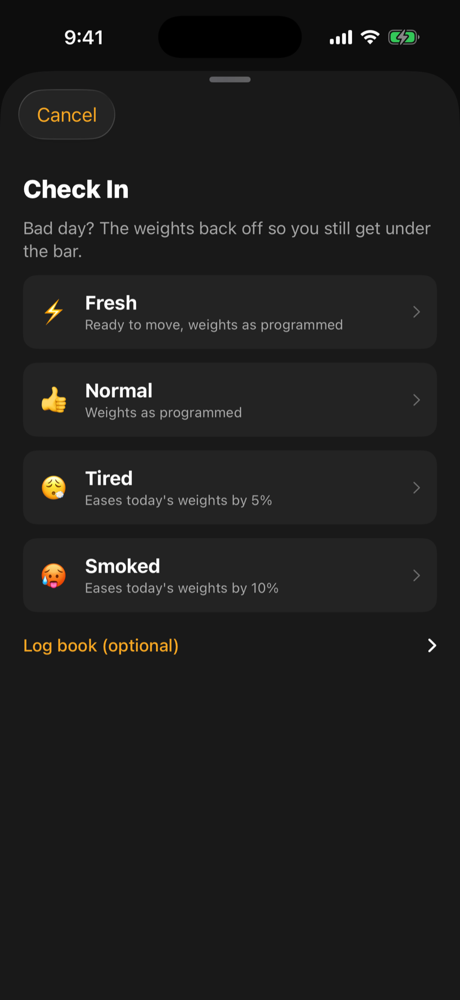
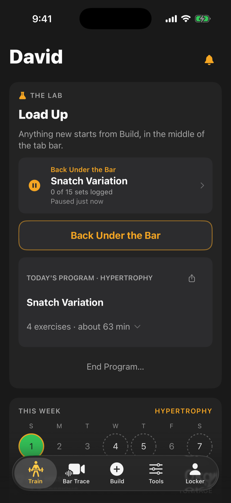
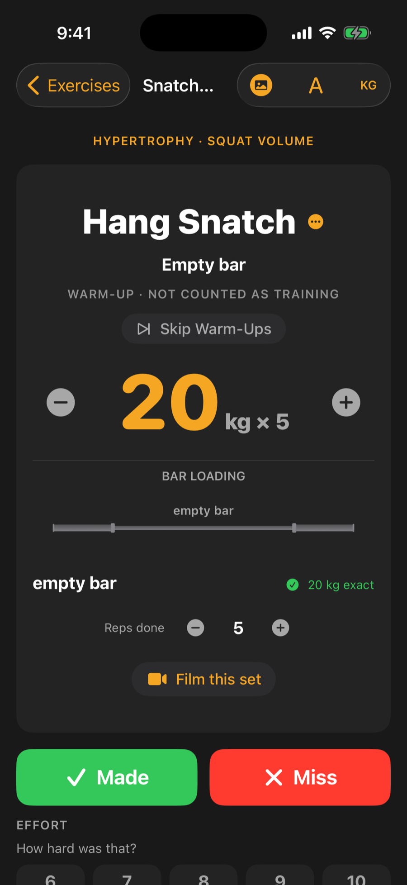

## Start a session

Open the **Train** tab. Whatever is waiting for you sits near the top.

- **Today's program day.** If you are following a program, a button starts today's session. You first see a quick check-in where you tap how you feel. Feeling below normal eases the day's fixed weights a little. One tap starts the session.
- **A session you left open.** It appears as a row saying which workout, how far in you were, and how long ago. Tap it to go back in.
- **Something new.** Tap **Build** (the plus in the middle of the tab bar), then **Build My Workout** for a session made around how you feel today.

Leaving a session never loses a set. Backing out just pauses it, and every set you logged is already saved.

A program day you started late and carried past midnight stays open, so the app does not close it for you in the middle of your workout. A day you stopped more than 12 hours ago is closed with the sets you logged.

## The set card

The session shows one set at a time. You see the exercise, the weight in large type, the target reps, and a picture of the bar with the plates on each side. The classic lifts, squats, pulls and presses open with warm-up sets first, starting with the empty bar. These are labelled as warm-ups and are not counted as training.

To log a set:

1. Check the weight. Tap the number to type a new one, or use the minus and plus buttons to step to the next weight your plates can build.
2. Check **Reps done**. Left alone, it counts the full target if you make the lift and zero if you miss. Nudge it if you did more or fewer.
3. Tap **Made** or **Miss**.
4. If you miss, you can tag what went wrong. The app then suggests causes, drills and cues for that fault.

Some sets ask how hard it felt. Pick the answer that fits, from easy to all out. Rating a working set as all out holds the next sets at that weight instead of climbing.

If you change a weight and make the lift, the remaining sets of that exercise move by the same amount, so you do not have to retype it each time.

## Rest timer

Once you log a set, the rest timer starts. By default it counts up so you can see how long you have rested. In **Settings > Training** you can turn on the countdown timer, which signals when rest is up even if your phone is locked. It keeps running if you leave the session and come back.

## The Accessibility view

If you prop your phone on the floor, or you simply want bigger controls, turn on the Accessibility view. Tap the **A** in the session's top corner, or go to **Settings > Accessibility**. The weight, reps and set label become very large, white on black. **Made** and **Miss** grow into huge buttons, and gray controls get a clear outline. You can still type or step the weight and set the reps.

:::tip
Switching the view on and off mid-session never changes your logged sets.
:::

## Finish

When every set is done, tap **Finish Session**. You can end early with **Cut It Short**, which saves what you have logged. A celebration screen shows any new records. From there, tap **Done** to leave, **Log how it went** to add a note, or **Share Workout**. The note is optional and stays available from the Log Book.

Changed your mind about a workout? The finish menu also offers **Discard Workout**, which asks before deleting.

<video controls muted playsinline preload="metadata" poster="/help/videos/log-a-set-poster.png" width="300" aria-describedby="log-a-set-desc">
  <source src="/help/videos/log-a-set.mp4" type="video/mp4">
</video>

<em>Video, 12 seconds, no sound: from the session list, open an exercise and tap Made. The rest timer starts and the next warm-up set loads.</em>

