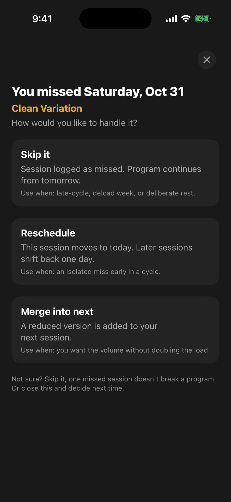
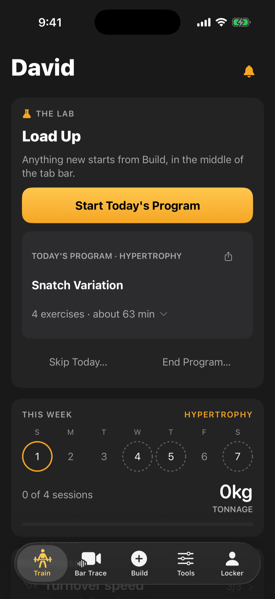

A program is a multi-week plan with every session laid out for you. Use one when you want structure instead of deciding each day.

## Start a program

1. Tap the **Build** button, then **Start a Program**.
2. Browse the list. Each card shows the number of weeks and the type of training.
3. Open one to preview its weeks and days.
4. Tap **Start This Program**, then **Start Today**. The program begins today. If you already have a program running, the app asks before it abandons that one, and the sessions you finished stay in your Log Book.

Beginner Foundation is free. Every other program is Pro, including the Classic Systems below.

## Classic systems (Pro)

Below the Program Library, **Classic Systems** holds four programs built on the principles of well-known national training traditions:

- **Bulgarian-Style High Frequency**: 6 weeks, 5 days. The classic lifts and squats, worked up to a heavy single by feel each day, then back-off singles.
- **Soviet-Era Multi-Lift**: 8 weeks, 4 days. A wide range of variations and pulls, in two waves with an easier week between.
- **Chinese-Style Volume and Strength**: 8 weeks, 5 days. High squat and pull volume, with upper back and posterior chain work every day.
- **Russian-Style Squat Cycle**: 6 weeks, 3 days. A squat block that ends in a test single, with light technique work to keep the lifts sharp.

Open one to see its tradition card, such as **The Bulgarian Tradition**: the principles it is built on and how it was adapted. The sets and percentages are the app's own, not a copy of any team's plan, and each is scaled to one session a day, since the originals were written for full-time athletes training more than once a day.

On a daily-heavy-single day, the back-off sets are a percentage of the top single you actually made, so their weight appears once you log it.

## Complexes in a program (Pro)

In Program Builder, a day's exercise list includes complexes beside single lifts. See [Build and log a complex](/help/train/complexes/).

:::note[Android]
On Android, an exercise row in Program Builder also offers **Make it a complex**, and a day offers **Add complex**.
:::

## How sessions are made

You do not build the sessions. Each day in the program lists its exercises, sets and reps, and most weights are a percentage of your record for that lift. When you start a day, the app turns those percentages into real weights using your current records, so the loads follow your progress.

Open today's session from the Train tab and it runs in the same live screen as any other workout.

## Pause, end or restart

On the Programs list and on the running program's own page you can **End Program** or **Restart from Week 1**. Both ask you to confirm. Ending only stops the remaining schedule. Sessions you already finished stay in your Log Book.

## Skipping and missed days

To skip a day on purpose, tap **Skip Today** on the Train tab before you start it. The day is recorded as skipped and the program carries on with the next one.

If a scheduled day passes without a session, the app asks what to do about it:

- **Skip it:** logged as missed, and the program continues from tomorrow. Good late in a cycle, in a deload week, or when you chose to rest.
- **Reschedule:** the session moves to today and later sessions shift back a day. Good for a single miss early on.
- **Merge into next:** a reduced version is added to your next session, so you keep some of the volume without doubling the load.

If you missed several days, you get one question about the most recent one. The older days are logged as missed once you choose. If you close it without choosing, nothing changes and it asks again next time.

:::tip
Not sure? Skip it. One missed session does not break a program.
:::

## The cycle report (Pro)

When a program ends, Pro members see a report of what it changed:

- Your records at the start against the end.
- Your strength ratios, start to end.
- Bar speed early against late, if you filmed enough clips.
- What to run next, with a suggested program.

Ending from inside a workout does not interrupt you with the report. Finished programs keep their report under **Previous Programs** on the Programs list.

