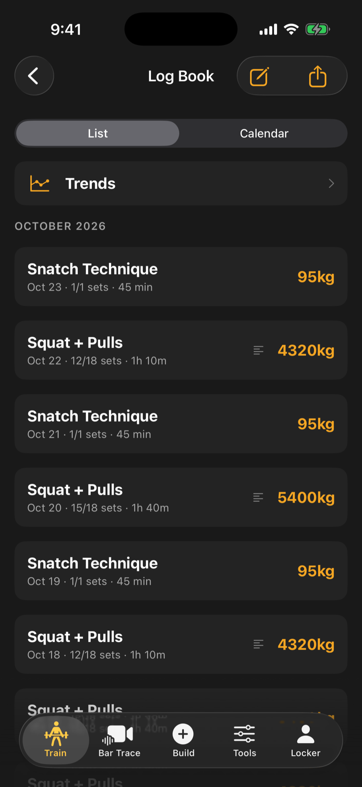

The PR Tracker holds your records. The Log Book holds everything you have trained.

## The PR Tracker

The tracker shows your main lifts, your Total (calculated for you), your secondary lifts, and a history for each lift with a progress line. A summary of your strength ratios links to the full ratios screen.

To add a record by hand, use the new PR button, enter the weight, and set the reps. One rep is a 1RM (the heaviest single you can lift).

## How records are saved

A record on the board is always a single. When you make a heavier set during a session, the app notices and celebrates it.

A record follows the set that earned it. If you step back to a set you just logged and correct the weight or the reps, or log it again as a miss, the record the session saved for it is corrected or removed to match. A record from an earlier session, or one you added by hand, is never touched.

A heavier set of 2 to 5 reps is saved as a **rep record**, such as a 2RM or 3RM. Rep records appear under **Rep records** on the lift's history. They never change your 1RM, your Total, or the weights the app prescribes. The first rep record at a given rep count has to be close to your max, so an ordinary working double is not celebrated.

:::note
If you reset your numbers in Settings, the board and Total still show your true records. Strength ratios use your current strength, and a line at the top tells you when a reset is active.
:::

## Make rate

Each lift's history includes **Make rate by intensity**. It shows one bar for each weight band you have attempted (as a share of your best), with the share you made and the number of sets. Bands with fewer than five sets are drawn faint, because a few sets say little. The headline names the heaviest band you make at least four times in five.

Below it you may see **Effort at the same weight**, which shows whether the same loads are feeling harder or easier lately, and **Load and bar speed**, which plots how fast the bar moves at each weight.

## The Log Book

The Log Book is a newest-first timeline grouped by month. It holds your sessions and your written reflections.

- Tap a session to see summary numbers and every set grouped by exercise. Filmed sets link to their bar path.
- Switch between **List** and **Calendar** to see trained days in a month view.
- Use the notes button to write a reflection. After 28 days the app suggests taking stock.
- To delete a workout, press and hold its row, or use the menu on its detail screen. You are asked to confirm. A PR you set in that session, your Apple Health workout and any bar-path clip are kept.

:::note[Android]
Press and hold works the same on Android: the menu on a Log Book row offers share and export, and Delete Workout.
:::

Use the menu at the top to export your history, or your PRs, stats and history, as CSV files.

## Import bar-speed data (Pro)

If you use a separate bar-speed device, you can bring its CSV file in.

1. Open the Log Book and tap the export and import menu.
2. Tap **Import Velocity Data (CSV)**.
3. Choose the file.

If the app does not recognize the layout, it asks you to match each column to what it holds (such as weight or speed), choose units, and check a preview before importing.
